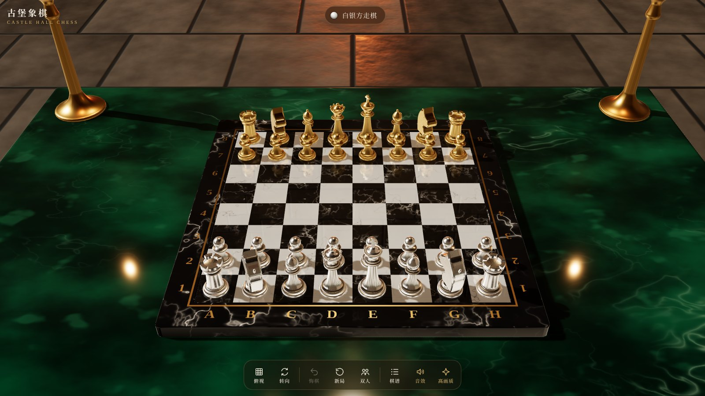

# 古堡象棋 · Castle Hall Chess

一款在浏览器里运行的 3D 国际象棋。场景设在古堡大厅，墨绿色大理石桌上摆着黑白大理石棋盘，双方棋子分别是白银和黄铜，带实时光影、石面倒影和金属反光。



## 特点

- **写实材质**：黑白大理石棋盘每一格纹理都不同；白银、黄铜棋子带轻微氧化斑点；桌面为墨绿大理石。所有纹理在浏览器中程序化生成，没有图片素材。
- **真实光影**：窗光投射柔和阴影，壁炉与烛火摇曳，棋子实时倒映在抛光的棋盘上（高画质模式）。
- **两种视角**：底部按钮一键切换「俯视正投影」与「透视轴测视角」，透视视角可拖动旋转、缩放。
- **完整规则**：王车易位、吃过路兵、兵升变、将军 / 将杀、逼和、三次重复、五十回合、子力不足判和。
- **双人 / 人机**：人机模式下玩家执白银，电脑执黄铜。
- **悔棋、棋谱、音效、画质切换**，棋局自动保存在本机浏览器。
- **跨平台**：Windows、macOS、iPad、iPhone、安卓手机均可直接在浏览器中运行，竖屏横屏自动适配。

## 在线体验（GitHub Pages）

1. 新建一个 GitHub 仓库，把本文件夹里的全部文件上传到仓库根目录（包括 `vendor/` 文件夹和 `.nojekyll` 文件）。
2. 打开仓库的 **Settings → Pages**。
3. **Source** 选择 `Deploy from a branch`，分支选 `main`，目录选 `/ (root)`，点 **Save**。
4. 等待一两分钟，访问 `https://你的用户名.github.io/仓库名/` 即可游玩。

## 本地运行

浏览器出于安全限制，不能直接双击 `index.html` 打开（ES 模块需要通过 HTTP 加载）。在本文件夹中启动任意静态服务器即可：

```bash
# 方式一：Python
python3 -m http.server 8000

# 方式二：Node.js
npx serve .
```

然后访问 <http://localhost:8000>。

## 操作说明

| 操作 | 方法 |
| --- | --- |
| 走棋 | 点选棋子，再点目标格（可走位置会亮起提示） |
| 旋转视角 | 透视视角下拖动画面 |
| 缩放 | 鼠标滚轮或双指捏合 |
| 切换俯视 / 透视 | 底部「俯视 / 透视」按钮，或键盘 `V` |
| 悔棋 | 底部「悔棋」按钮，或 `Ctrl / ⌘ + Z` |

## 项目结构

```
index.html                 游戏全部代码（HTML + CSS + JavaScript）
vendor/three/              three.js r160 及所用扩展（本地托管，无需外网 CDN）
docs/screenshot.jpg        README 截图
.nojekyll                  让 GitHub Pages 原样发布所有文件
```

## 技术说明

- 渲染：[three.js](https://threejs.org/) r160，WebGL 2，物理光照 + ACES 色调映射，PCF 软阴影，平面实时反射，环境贴图由场景本身生成。
- 棋子：车床旋转体（Lathe）建模，马为挤出造型。
- AI：Alpha-Beta 剪枝 + 静态搜索 + 迭代加深，按时间限制思考。
- 走法生成已通过标准 perft 测试局面验证。
- 需要支持 WebGL 2 的浏览器：Chrome、Edge、Firefox、Safari 15 及以上。手机默认使用「标准」画质以节省电量，可手动切换为「高画质」。

## 许可证

本项目以 [MIT License](LICENSE) 发布。three.js 遵循其自身的 MIT 许可证（见 `vendor/three/LICENSE`）。
